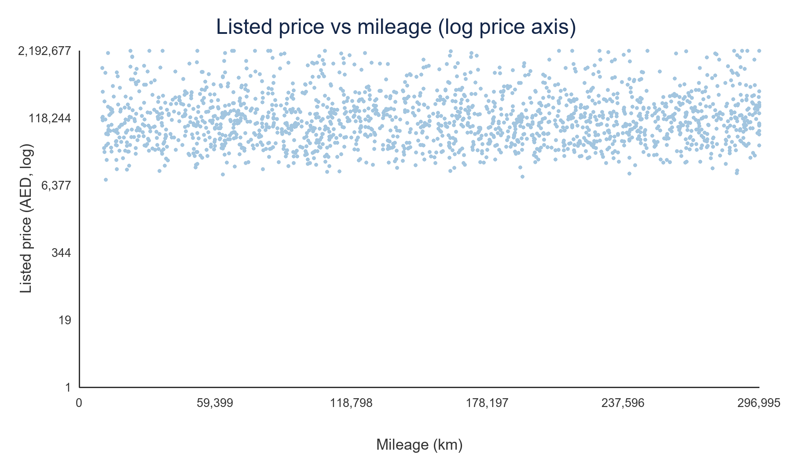
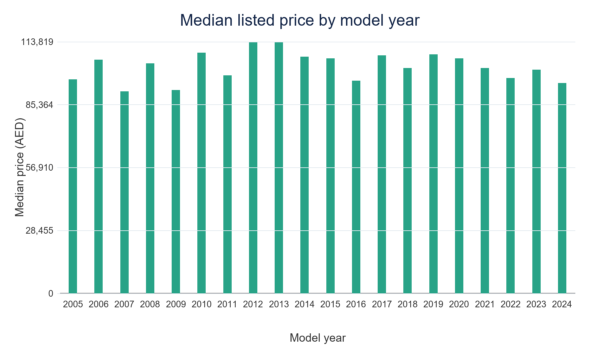

# Phân tích giá niêm yết xe đã qua sử dụng tại UAE

**Môn:** ADY201m — AI, Data Science with Python & SQL  
**Ngày tạo:** 11/10/2026  

## Tóm tắt

Dự án phân tích 10.000 tin đăng xe đã qua sử dụng ở UAE với 12 trường, trong đó `Price` là giá niêm yết bằng AED. Quy trình gồm kiểm tra dữ liệu, làm sạch, đưa dữ liệu vào SQLite chuẩn hóa, truy vấn SQL, thống kê bằng pandas/numpy, kiểm định so sánh SUV với Sedan và đánh giá hồi quy tuyến tính baseline dùng năm sản xuất/số km.

Giá trung vị trong mẫu là **102.766 AED**, trong khi trung bình là **245.235 AED**, cho thấy một số tin giá cao kéo trung bình lên. SUV có trung vị **118.414 AED**, Sedan **70.287,5 AED**; phép kiểm định Mann–Whitney U xấp xỉ cho thấy phân phối hai nhóm khác nhau trong mẫu (p ≈ **1,44 × 10⁻⁷²**). Tuy nhiên, tương quan thô giữa `Price` và `Year`/`Mileage` gần bằng 0. Hồi quy baseline Year + Mileage đạt MAE khoảng **193.896 AED**, RMSE **484.788 AED**, R² **−0,079** trên tập kiểm tra; đây là hiệu suất yếu và không đủ để dùng định giá xe.

## 1. Mục tiêu và câu hỏi nghiên cứu

**Mục tiêu:** mô tả giá niêm yết xe trong nguồn dữ liệu UAE và khảo sát xem các thuộc tính xe quan sát được liên hệ thế nào với giá.

- **RQ1:** Giá thay đổi ra sao theo năm, số km, hãng, loại thân xe và địa điểm?
- **RQ2:** Phân phối giá SUV và Sedan có khác nhau trong mẫu không?
- **RQ3:** Hồi quy tuyến tính baseline chỉ dùng `Year` và `Mileage` dự đoán giá trên dữ liệu chưa thấy tốt đến đâu so với dự đoán trung vị train?

Đây là câu hỏi mô tả/khám phá. Kết quả không chứng minh yếu tố nào gây ra thay đổi giá.

## 2. Nguồn và cấu trúc dữ liệu

Nguồn là [UAE Used Car Prices & Features (10K+ Listings)](https://www.kaggle.com/datasets/alikalwar/uae-used-car-prices-and-features-10k-listings) của Ali Kalwar trên Kaggle. Trang bộ dữ liệu ghi giấy phép **CC BY-SA 4.0**. Bộ dữ liệu cung cấp các trường hãng, mẫu, năm, giá, số km, loại thân xe, xi-lanh, hộp số, nhiên liệu, màu, địa điểm và mô tả.

Một bản ghi được xem là một tin đăng. `Price` được hiểu là giá đăng bán AED, không phải giá giao dịch đã xác nhận. Tệp dự án có 10.000 dòng và 12 cột.

## 3. Phương pháp và chuẩn bị dữ liệu

Quy trình áp dụng các bước xác định bài toán, nạp/profile dữ liệu, làm sạch, phân tích bằng SQL/Python, đánh giá baseline và báo cáo giới hạn.

- Giữ nguyên CSV nguồn; tạo `clean_car_listings.csv` riêng.
- Cắt khoảng trắng đầu/cuối ở trường văn bản. Có **9.869** giá trị `Location` có khoảng trắng thừa.
- Chuẩn hóa ô rỗng, chuỗi `None`, `Unknown` thành thiếu ở `Cylinders`: tổng cộng **155** giá trị chưa biết.
- Chuyển `Year`, `Price`, `Mileage` thành số; không loại giá cao chỉ vì nằm xa trung vị.
- Không tìm thấy bản ghi trùng hoàn toàn theo 12 cột.
- Dùng SQLite với bảng `car_listing` cùng các bảng chiều `make`, `body_type`, `emirate`; truy vấn trong notebook minh họa `JOIN`, `GROUP BY`, `HAVING`, `ORDER BY` từ Python qua `sqlite3`/`pandas.read_sql_query`.

## 4. Kết quả mô tả

| Chỉ số | Giá trị |
|---|---:|
| Số tin đăng | 10.000 |
| Giá thấp nhất | 7.183 AED |
| Q1 của giá | 50.352,5 AED |
| Trung vị giá | 102.766 AED |
| Q3 của giá | 231.248 AED |
| Giá cao nhất | 14.686.975 AED |
| Trung bình giá | 245.234,5 AED |
| Năm sản xuất | 2005–2024; trung vị 2014 |
| Số km | 10.006–299.996 km; trung vị 154.370,5 km |

Khoảng cách lớn giữa trung bình và trung vị cùng giá tối đa cao cho thấy phân phối giá lệch phải và có các tin rất đắt. Nên dùng median/quantile để mô tả trung tâm, đồng thời kiểm tra các bản ghi đầu cao theo hãng/mẫu/mô tả trước khi kết luận.

SUV là loại thân xe phổ biến nhất (**4.607** tin), tiếp theo là Sedan (**2.790**). Dubai chiếm **8.011** tin; do đó thống kê địa điểm chủ yếu phản ánh Dubai. Gasoline chiếm 9.714 tin; nhóm nhiên liệu Hybrid/Electric nhỏ hơn nhiều và so sánh các nhóm hiếm cần thận trọng.

### Một số giá trung bình từ truy vấn SQL

| Hãng (tối thiểu 50 tin) | Số tin | Giá trung bình |
|---|---:|---:|
| Rolls-Royce | 141 | 1.827.530 AED |
| Lamborghini | 112 | 1.608.101 AED |
| Ferrari | 123 | 1.225.834 AED |
| Bentley | 138 | 560.116 AED |
| Mercedes-Benz | 1.486 | 372.083 AED |

Các trung bình này không điều chỉnh năm, mẫu xe, tình trạng hoặc phiên bản, và có thể bị ảnh hưởng bởi ngoại lệ. Không nên diễn giải thành thứ hạng giá cố định của toàn thị trường.

### Biểu đồ

Biểu đồ SVG được sinh bằng fallback thuần Python trong môi trường hiện tại. Nếu cài matplotlib/seaborn, script cũng lưu PNG.

## 5. Kiểm định SUV và Sedan

Giả thuyết không: phân phối `Price` của SUV và Sedan giống nhau. Giả thuyết đối: hai phân phối khác nhau. Dùng Mann–Whitney U hai phía với xấp xỉ chuẩn có hiệu chỉnh ties vì giá lệch phải.

- SUV: n = 4.607; median = **118.414 AED**.
- Sedan: n = 2.790; median = **70.287,5 AED**.
- U nhỏ hơn = 4.822.934,5; z xấp xỉ = −18,02; p xấp xỉ = **1,44 × 10⁻⁷²**.

Ở mức ý nghĩa 0,05, bác bỏ giả thuyết hai phân phối giống nhau trong mẫu này. Mức p-value không cho biết nguyên nhân và không tự loại trừ nhiễu do hãng, mẫu, năm hoặc địa điểm; chênh lệch mẫu không đảm bảo áp dụng cho thị trường ngoài bộ dữ liệu.

## 6. Tương quan và baseline hồi quy

Tương quan Pearson của giá với `Year` là **0,0002**, với `Mileage` là **0,0107**; tương quan Spearman lần lượt khoảng **−0,0001** và **0,0072**. Với các giá trị gần 0 này, hai biến số đơn lẻ hầu như không có liên hệ đơn điệu/tuyến tính thô với giá trong toàn bộ mẫu hỗn hợp nhiều hãng và mẫu xe.

Baseline hồi quy dùng log tự nhiên của `Price`, hai predictor `Year`/`Mileage` đã chuẩn hóa, chia dữ liệu ngẫu nhiên cố định thành 8.000 train và 2.000 test. Dự đoán được đổi về AED trước khi tính metric.

| Mô hình | MAE (AED) | RMSE (AED) | R² (AED) |
|---|---:|---:|---:|
| Dự đoán median train | 193.478 | 488.599 | −0,096 |
| Hồi quy log-price: Year + Mileage | 193.896 | 484.788 | −0,079 |

Hồi quy giảm RMSE một ít so với baseline median, nhưng MAE lại cao hơn; cả hai R² đều âm theo công thức so với trung bình test, cho thấy dự đoán kém. Baseline hiện tại **không phù hợp làm công cụ định giá**. Cần xem xét thêm hãng/mẫu/loại thân xe, tình trạng/tiện nghi được trích xuất từ mô tả, kiểm soát ngoại lệ, mã hóa phân loại, cross-validation và đánh giá riêng theo phân khúc.

## 7. Kết luận

Trong bộ dữ liệu này, tin SUV có trung vị giá cao hơn Sedan và hai phân phối có khác biệt thống kê theo kiểm định đã chọn. Tuy vậy, năm sản xuất và số km xét riêng gần như không tương quan với giá trong mẫu toàn cục. Các tin có mẫu xe/nhãn hiệu và mức giá rất khác nhau có thể làm mờ liên hệ đơn giản này. Baseline hai biến đạt hiệu suất yếu, vì thế câu trả lời thực tế hiện tại là: **không nên dự đoán giá chỉ bằng năm sản xuất và số km**.

## 8. Giới hạn và đạo đức sử dụng

1. Đây là dữ liệu tin đăng, không có giá giao dịch cuối cùng hay ngày bán.
2. Mẫu có thể không đại diện toàn bộ thị trường UAE; Dubai chiếm phần lớn quan sát.
3. Giá cực lớn cần xác minh; chưa xóa hoặc winsorize để tránh quyết định tùy tiện.
4. Các nhóm nhiên liệu/địa điểm ít mẫu có ước lượng không ổn định.
5. `Description` là văn bản tự do; thông tin tình trạng có thể cần NLP và xác minh thủ công.
6. Kiểm định Mann–Whitney sử dụng xấp xỉ chuẩn, được nêu rõ là p-value xấp xỉ.
7. Hồi quy chưa có feature engineering phong phú, cross-validation, prediction intervals hoặc phân tích phần dư đầy đủ.
8. Không dùng kết quả này làm định giá cá nhân hoặc khuyến nghị giao dịch.

## 9. Khả năng tái lập

Hướng dẫn chạy nằm trong `README.md`. Notebook chính ở `notebooks/eda/02_data_analyze.ipynb`; script phân tích ở `scripts/analysis/run_analysis.py`. Kết quả tổng hợp có thể đối chiếu với `data/processed/results.json` và các CSV đầu ra.

## Tài liệu tham khảo

- Kalwar, A. *UAE Used Car Prices & Features (10K+ Listings)*. Kaggle. https://www.kaggle.com/datasets/alikalwar/uae-used-car-prices-and-features-10k-listings
- FPT University Learning Materials. *ADY201m syllabus, ID 13675*. https://flm.fpt.edu.vn/gui/role/student/SyllabusDetails?sylID=13675 (FPT login may be required; verify against the current class version).
